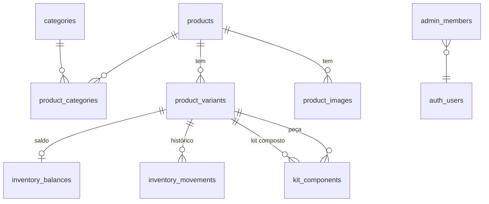

# Plano do banco — Catálogo e Estoque (Fase 1)

**Estado:** aprovado e **aplicado** em 03/11/2026 no projeto `ar-acessorios-dev` (escolhas da §6 viraram CAT-DEC-017, 022, 023 e 024).

| Arquivo | Conteúdo |
|---|---|
| `supabase/migrations/20261103080000_catalogo_estoque_tabelas.sql` | Tabelas, regras e gatilhos |
| `supabase/migrations/20261103080100_catalogo_estoque_funcoes.sql` | Disponibilidade, painel e funções de estoque |
| `supabase/migrations/20261103080200_catalogo_estoque_acesso.sql` | RLS, permissões e fotos no Storage |
| `supabase/seed.sql` | Catálogo de demonstração (gerado por `node scripts/gerar-seed.ts`) |
| `supabase/tests/catalogo_estoque.sql` | Testes da §8, em transação desfeita no fim |
**Base:** Módulo 01 e decisões D-011, D-018, CAT-DEC-001 a 021.
**Fora deste plano:** pedidos, pagamentos, reserva de estoque no checkout (Fase 3). As tabelas já aceitam esses movimentos, mas nenhuma regra deles é implementada agora.

## 1. Onde fica

| Item | Proposta |
|---|---|
| Projeto | `ar-acessorios-dev` (ref `pmhipriryqsblhonysay`), organização "Markplace ar", região **São Paulo (sa-east-1)**, plano gratuito. **Criado em 03/11/2026, ainda sem tabelas** |
| Por que um novo | O projeto anterior fica em Oregon (EUA) e a região não muda depois de criada. Decidido em 03/11/2026: banco no Brasil. O projeto de Oregon está vazio e não é usado |
| Produção | Outro projeto, criado só no lançamento (deploy de produção não está autorizado) |
| Migrações | Arquivos SQL versionados em `supabase/migrations/`, aplicados em ordem; nenhuma destrutiva |

## 2. Tabelas

| Tabela | Para quê | Regras no banco |
|---|---|---|
| `categories` | Categorias da vitrine | `slug` único; ordem; ativa/inativa |
| `products` | Página comercial | `slug` único; status `rascunho · ativo · arquivado`; tipo `simples · kit_estoque_proprio · kit_composto` (CAT-DEC-004); unidade `unidade · par · conjunto` (CAT-DEC-002) |
| `product_categories` | Produto em várias categorias (CAT-DEC-016) | Par produto+categoria único |
| `product_variants` | O que se vende (SKU) | `sku` único (CAT-DEC-017); preço em centavos > 0 (CAT-DEC-005); preço promocional < preço normal, com início e fim (CAT-DEC-020); estoque mínimo (CAT-DEC-021); combinação de atributos única por produto |
| `kit_components` | Peças de um kit composto e quantidades (CAT-DEC-019) | Só para variações de kit composto; peça não pode ser outro kit composto; quantidade > 0 |
| `product_images` | Fotos no Storage | Texto alternativo obrigatório; no máximo uma capa por produto |
| `inventory_balances` | Saldo e reservado por SKU | `saldo ≥ 0`, `reservado ≥ 0`, `reservado ≤ saldo`; kit composto **não** tem saldo (é calculado) |
| `inventory_movements` | Histórico de toda movimentação (CAT-DEC-012) | Motivo e operador obrigatórios em ajustes; **ninguém edita nem apaga** |
| `admin_members` | Quem acessa o painel | Um papel só (`admin`) até a cliente responder D-013 |

**Disponibilidade** (calculada, não guardada): SKU comum = saldo − reservado; kit composto = menor ⌊disponível da peça ÷ quantidade⌋ entre as peças (CAT-DEC-019).

## 3. Como o estoque muda

O painel **nunca** grava saldo direto. Toda mudança passa por uma função no banco que, numa única transação, confere permissão, trava a linha do saldo, aplica a mudança só se o resultado continuar válido e grava o histórico.

| Função | Faz | Decisão |
|---|---|---|
| `registrar_entrada(variação, quantidade, motivo)` | Soma ao saldo | CAT-DEC-012 |
| `registrar_ajuste(variação, diferença, motivo)` | Soma ou subtrai; recusa se ficar negativo | CAT-DEC-012 |
| `registrar_contagem(variação, contado, motivo)` | Iguala o saldo ao contado e registra a diferença | CAT-DEC-021 |

Duas pessoas ajustando o mesmo SKU ao mesmo tempo: a segunda espera a primeira terminar e recalcula. O saldo nunca fica negativo.

## 4. Quem vê e quem altera (RLS)

| Dado | Visitante da loja | Admin |
|---|---|---|
| Categorias ativas, produtos **ativos**, suas variações, fotos e composição de kits | Lê | Lê e altera |
| Produtos em rascunho ou arquivados | Não vê | Lê e altera |
| Disponibilidade | Só **disponível sim/não** por SKU | Quantidade exata |
| Saldo, histórico, estoque mínimo | Não vê | Lê; altera só pelas funções da §3 |
| `admin_members` | Não vê | Lê; ninguém se promove pelo site (só pelo painel do Supabase) |
| Fotos no Storage | Lê | Envia e remove |

Apagar produto: só em rascunho. Produto com histórico é arquivado (Documento Mestre §5.1).

## 5. Login do painel

E-mail e senha pelo Supabase Auth. **Cadastro público desligado**: os acessos são criados por você no painel do Supabase e liberados em `admin_members`. A chave secreta (`service_role`) nunca vai para o site.

## 6. Escolhas que fiz e precisam do seu ok

1. **Atributos da variação em JSON** (`{"banho":"Ouro 18k","tamanho":"P"}`), aceitando só as cinco chaves da D-011. É mais simples que uma tabela por atributo e atende enquanto Q-CAT-01 (atributos por tipo) está em aberto. O Módulo 01 deixava essa escolha pendente.
2. **Marcadores "Novo" e "Destaque" manuais** no produto, para alimentar "Lançamentos" e "Mais vendidos" da home até existirem vendas reais.
3. **Visitante vê só disponível sim/não**, sem a quantidade, para não expor estoque (Módulo 01 §6). Mensagens como "últimas unidades" ficam para depois, se a cliente quiser.
4. **SKU editável** por enquanto: a regra de travar o SKU depois da primeira movimentação é a proposta PR-005, ainda não aprovada.

## 7. Dados de teste

O banco de desenvolvimento recebe os 19 produtos fictícios do protótipo, para a vitrine e o painel funcionarem de verdade. Eles continuam marcados como demonstração.

## 8. Testes antes de considerar pronto

- Visitante não lê rascunho, saldo nem histórico, e não grava nada.
- Admin não consegue alterar saldo direto, só pelas funções.
- Ajuste que deixaria saldo negativo é recusado.
- 20 ajustes simultâneos no mesmo SKU terminam com o saldo correto.
- Disponibilidade de kit composto bate com a fórmula, inclusive com reservas.
- Histórico não aceita edição nem exclusão.
- Os avisos de segurança do Supabase (advisors) não apontam problemas.

## 9. Riscos

| Risco | Cuidado |
|---|---|
| Erro de RLS expor dados | Testes da §8 com usuário anônimo, admin e usuário comum |
| Projeto gratuito pausa após 7 dias sem uso | Normal em desenvolvimento; reativa pelo painel. Produção será paga |
| Mudar atributos de JSON para tabela depois | Migração simples enquanto houver poucos produtos |
